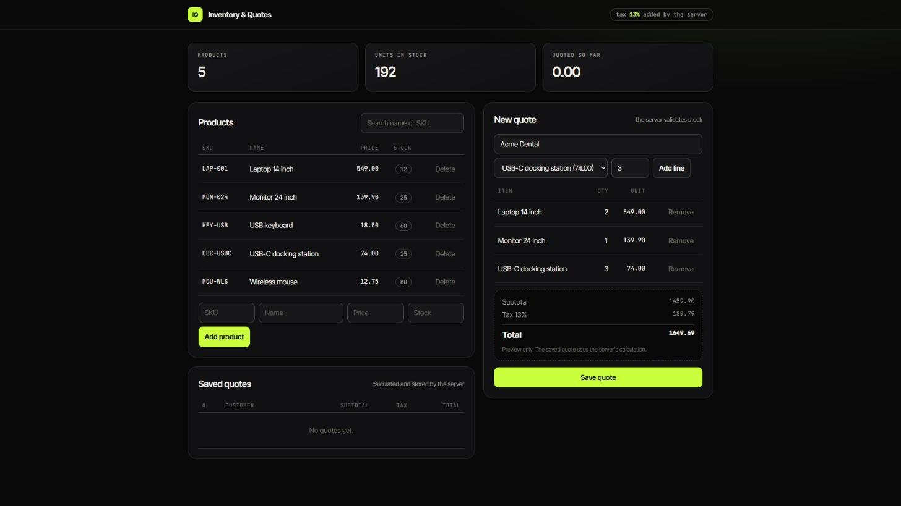

# Inventory & Quotes

A web application for managing a product inventory and issuing customer quotations. The server owns the business
rules (stock validation, tax and totals), so the client can never submit incorrect figures. It runs on sample data and
models the inventory-and-quotation workflow I work with professionally.



## Features

- Create, list, update and delete products (SKU, name, price, stock).
- Build a quotation from several products. The server validates stock and calculates subtotal, tax (13%) and total.
- Review saved quotations, including the detail of every line.
- Single-page interface on top of a JSON API: product search, low-stock indicators, a live totals preview while a
  quote is being built, and a clear message for every error.
- All data coming from the API is escaped before it is rendered.

## Stack

Python 3, Flask, SQLite, vanilla JavaScript, pytest.

## Getting started

```bash
python -m venv .venv
# Windows: .venv\Scripts\activate      macOS/Linux: source .venv/bin/activate
pip install -r requirements.txt
python seed.py        # optional: loads example products
python app.py         # http://127.0.0.1:5000
```

## Tests

```bash
pytest
```

The suite runs against a temporary database, so it never touches real data.

## API

| Method | Path | Description |
|--------|------|-------------|
| GET | `/api/products` | List products |
| POST | `/api/products` | Create a product |
| PUT | `/api/products/<id>` | Update a product |
| DELETE | `/api/products/<id>` | Delete a product (rejected if it appears in a quote) |
| GET | `/api/quotes` | List quotations |
| POST | `/api/quotes` | Create a quotation: `{customer, items: [{product_id, quantity}]}` |
| GET | `/api/quotes/<id>` | A quotation with its lines |

Errors are returned as JSON, `{"error": "..."}`, with a meaningful status code (400, 404 or 409).

## Design decisions

- **Totals are computed on the server.** The browser only shows a preview; the stored quotation always uses the
  server's calculation.
- **The database enforces integrity.** `CHECK` constraints and foreign keys keep the data consistent even if
  validation in the application code were bypassed.
- **Application factory.** `create_app` builds the app with its own database path, which is what lets the tests run
  against an isolated temporary database.

## Limitations and next steps

- The tax rate is a constant in `app.py` (`TAX_RATE`).
- Stock is validated when a quotation is created but not yet reduced. The natural next step is a "confirm quotation"
  action that deducts stock.
- No authentication or pagination yet, as it is a demonstration project.
